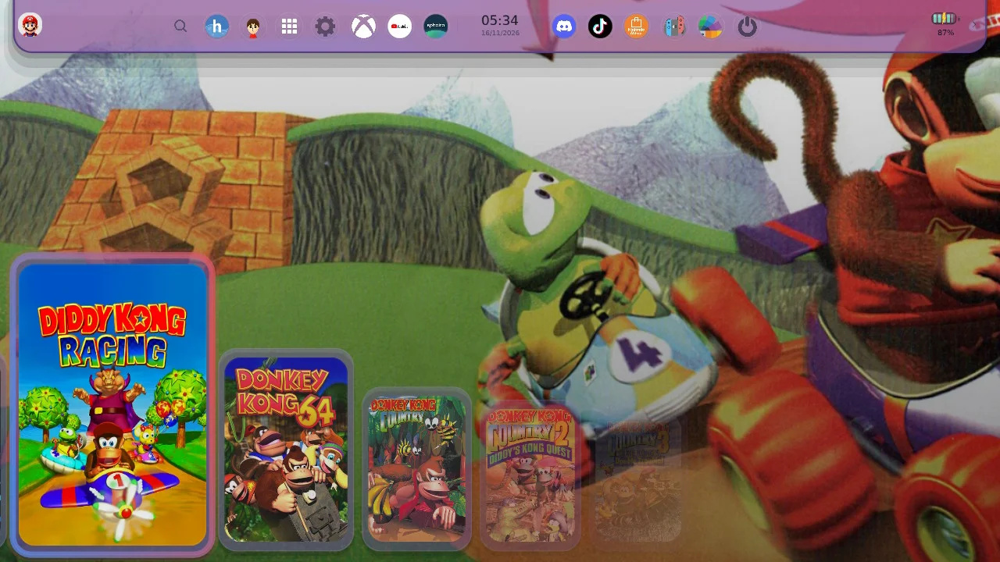
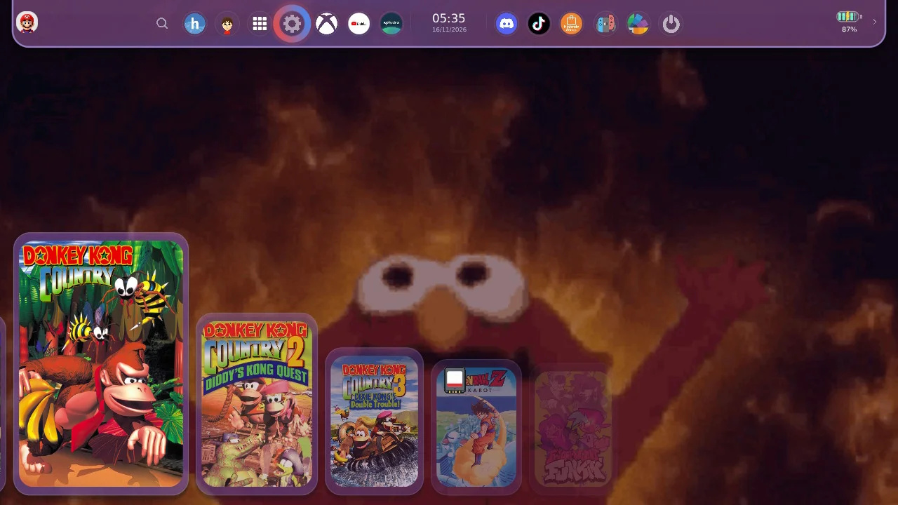
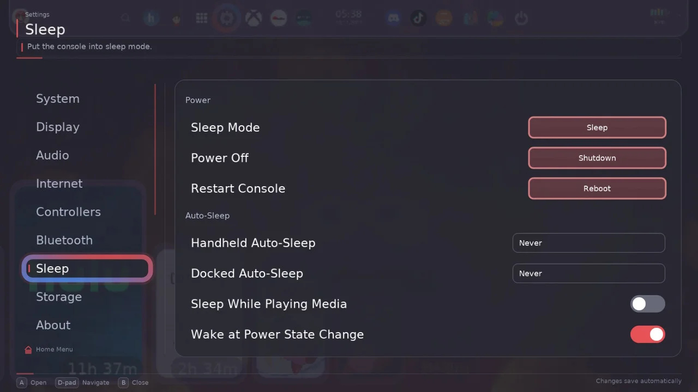
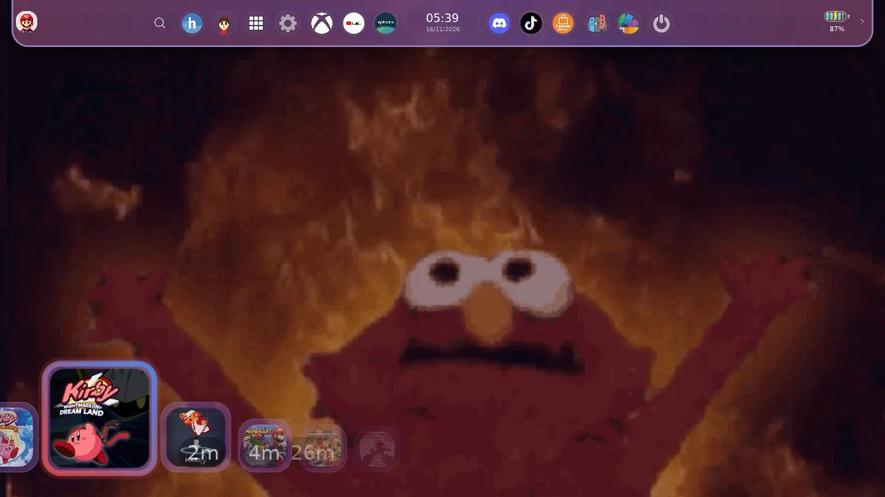
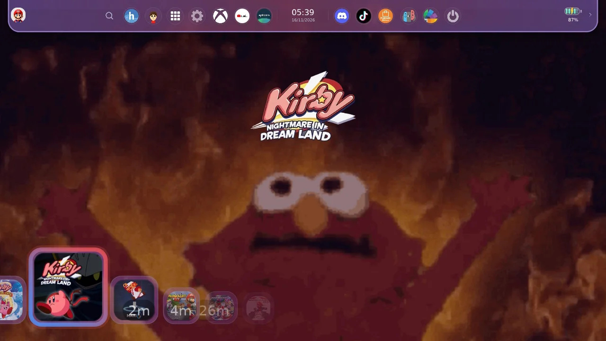

<div align="center">
    <h1>SwitchU</h1>
    <p>A Wii U-style custom HOME menu replacement for Nintendo Switch</p>
</div>

<p align="center">
  <a rel="LICENSE" href="https://github.com/paparys/SwitchU/blob/master/LICENSE">
    
  </a>
  <a rel="VERSION" href="https://github.com/paparys/SwitchU/releases">
    
  </a>
  <a rel="BUILD" href="https://github.com/paparys/SwitchU/actions">
      
  </a>
</p>

---

SwitchU replaces the Nintendo Switch HOME menu with a Wii U-inspired interface.
It keeps your installed games and folders, adds a theme shop and a deep set of
HOME customization tools, and can be enabled or disabled at boot with the
included manager.

> **Fork notice:** This is an independently maintained fork of
> [SwitchU by PoloNX](https://github.com/PoloNX/SwitchU), based on upstream
> v1.4.0. It has not been merged with upstream v1.4.1. Fork work lives on the
> `switchu-ui-fork` branch and is released as `1.4.0-fork.1`. The original
> project, design and code remain credited to PoloNX and the upstream
> contributors. Fork-specific changes are maintained by
> [@paparys](https://github.com/paparys) under the same GPLv3 license. This is
> not an official upstream release.

> **Custom firmware required.** SwitchU runs as an Atmosphère HOME-menu
> override. Read the install steps before copying anything to your SD card, and
> back up your SD card first.

## Contents

- [Install](#install)
- [First boot](#first-boot)
- [Using SwitchU](#using-switchu)
- [Fork changes](#fork-changes)
- [Features](#features)
- [Settings reference](#settings-reference)
- [SwitchU Manager](#switchu-manager)
- [Optional MTP](#optional-mtp)
- [Data and backups](#data-and-backups)
- [Build from source](#build-from-source)
- [Troubleshooting](#troubleshooting)
- [Uninstall](#uninstall)
- [Credits](#credits)
- [License](#license)

## Screenshots



<details>
  <summary><b>More screenshots</b></summary>






</details>

## Install

### Requirements

- A Nintendo Switch that can boot [Atmosphère](https://github.com/Atmosphere-NX/Atmosphere).
- A microSD card with enough free space for the menu assets.
- A way to read and write the SD card from your computer.
- Internet access only for Theme Shop browsing and Manager update checks.

### Fresh install

1. **Back up your SD card.** At minimum, keep a copy of the folders you are
   about to merge into.
2. Download `SwitchU.zip` from the
   [latest release](https://github.com/paparys/SwitchU/releases/latest).
3. Extract the archive. A normal release contains:
   ```text
   atmosphere/
   switch/
   optional/        (only when the release includes optional components)
   ```
4. Copy the **contents** of `atmosphere/` and `switch/` to the **root** of your
   SD card. Merge them with the folders already there; do not create an extra
   `SwitchU/` wrapper folder.
5. If you want the optional USB MTP feature, also copy
   `optional/switchu-mtp/atmosphere/` to the SD root. Otherwise leave
   `optional/` alone. See [Optional MTP](#optional-mtp).
6. Eject the SD card safely, put it back in the console, and boot Atmosphère.
7. SwitchU should now appear instead of the stock HOME menu.

The important installed paths are:

| SD path | What it is |
|---|---|
| `atmosphere/contents/0100000000001000/exefs.nsp` | The SwitchU boot sysmodule that overrides the HOME menu. |
| `switch/SwitchU/` | Menu payload, fonts, sounds, themes, icons and translations. |
| `switch/SwitchU-Manager/SwitchU-Manager.nro` | Manager app, launched from hbmenu. |
| `optional/switchu-mtp/` | Optional MTP sysmodule; not installed by default. |

> **Do not copy the `sd_out` folder itself.** `sd_out` is an install tree; its
> **contents** belong at the SD card root.

### If SwitchU does not appear

1. Make sure Atmosphère boots normally without SwitchU.
2. Open the homebrew menu (hbmenu) and launch **SwitchU Manager** from
   `switch/SwitchU-Manager/SwitchU-Manager.nro`.
3. Choose **Enable SwitchU**, confirm, and select **Restart now**.
4. If Manager reports a missing or conflicting override, re-copy the
   `atmosphere/contents/0100000000001000/` folder from the release and try
   again.

## First boot

On the first launch, SwitchU shows a short tutorial explaining navigation.
After that, the HOME menu opens with your installed games, folders and sidebar
shortcuts.

The initial configuration is created automatically under
`sdmc:/config/SwitchU/`. Keep that folder when updating if you want to preserve
your settings. Built-in themes and menu assets live under
`sdmc:/switch/SwitchU/`; user themes, icon packs and music are stored on the SD
card.

## Using SwitchU

- **D-pad / left stick** moves focus.
- **A** selects or opens.
- **B** goes back or closes an overlay.
- **+** on a game opens its per-game options.
- **Touch** works throughout the UI, including scrolling and sliders.
- **Minus** opens **All Apps**. On an empty HOME page, hold **Minus** to remove
  that page.
- **All Apps:** **A** launches, **X** opens game options, **Y** opens the sort
  and favourites menu, **L/R** change pages, and **B** closes the screen.
- **Search** is a field in the Carousel shortcut strip. Type part of a game
  name, then pick a result to jump to its HOME tile.
- **Change View** cycles **Carousel**, **Shelf (5x2)**, **Showcase (3x2)** and
  **Poster Wall (6x2)**. Inside a folder it toggles the folder's grid and
  single-row views.
- **Quick Settings** opens from the battery widget and provides brightness,
  volume, network, music and power controls.
- **Theme Shop** in the sidebar opens the installed and community theme store.
- **Settings** in the sidebar opens the full settings app.
- **Sleep** and the power menu are available from the sidebar and Quick
  Settings.

## Fork changes

This fork is based on upstream SwitchU v1.4.0 and has not been merged with
upstream v1.4.1. Compared with that base:

**Added**

- **All Apps** screen with a configurable grid, A-Z / Recently played /
  Favourites sorting, favourite toggling, playtime and page controls.
- **Game search** in the Carousel shortcut strip, with a result list that
  jumps focus to the matching HOME tile.
- **Playtime tracking** (`sdmc:/config/SwitchU/playtime.json`) and **Recent**
  game ordering.
- **Four HOME layouts**: Carousel, Shelf (5x2), Showcase (3x2) and Poster Wall
  (6x2).
- **Local wallpapers**, including a preview-before-apply picker, an
  animated-wallpaper toggle and a 5–30 fps cap.
- **Style** settings tab, including chrome, focus, title capsule, top bar,
  wallpaper and motion controls plus three Look presets.
- **All Apps grid controls** in **Icons & Wallpaper**: 3–8 columns and 2–5
  rows.
- **Frame Tap-aware memory handling** when a connected viewer needs capture
  headroom.
- **Windows build recipe** (`build_windows.sh`).
- Shared chrome, focus, text-fitting and keycap helpers plus a frame profiler
  (internal rendering changes).

**Changed**

- **Change View** now cycles the four HOME layouts instead of switching only
  between grid and single-row.
- The sidebar exposes seven applet shortcuts, including **All Apps**.
- **Game order** offers **My order**, **A-Z** and **Recent**.
- Layout presets and All Apps grid controls sit at the bottom of **Icons &
  Wallpaper** instead of separate rail entries.

**Removed or retired**

- On-screen page-arrow controls and their left/right arrow assets; D-pad,
  ZL/ZR, All Apps L/R and touch swipes still page through the library.
- The standalone **Opacity** tab; panel appearance is now controlled from
  **Style**, and the old opacity colour/solid controls are no longer exposed.
- The standalone **All Apps** and **Layout presets** rail entries. Their
  controls remain at the bottom of **Icons & Wallpaper**.
- Unused Theme Shop loading GIF/WebP art, the default leaf icon, the page-arrow
  icons and the liquid-glass shader. Panels now use themed translucent or flat
  plates.

Everything else from upstream v1.4.0 remains, including Theme Shop, folders,
SteamGridDB artwork, Manager, MTP, themes, music and accessibility.

## Features

### A complete HOME-menu replacement

- Runs as an Atmosphère `qlaunch` override, so it becomes the HOME menu rather
  than a separate app.
- Wii U-inspired focus movement, tile depth, page transitions and launch
  animations.
- Four HOME layouts: **Carousel** (single row), **Shelf (5x2)**, **Showcase
  (3x2)** and **Poster Wall (6x2)**, with an animated switch between them.
- Page and row navigation designed for both controllers and touch.
- Multiple user profiles, each with their own saved settings, plus an optional
  default profile.
- First-run tutorial and per-user lock-screen support.
- Original Nintendo HOME menu can be restored at any time from Manager.

### Game library

- Shows installed games, game cards and folders on HOME.
- **All Apps** lists the installed applications in a paged grid, opened from
  the sidebar or with **Minus**:
  - Sort by **A-Z**, **Recently played** or **Favourites** with **Y**.
  - Add or remove the focused app from Favourites from the same menu.
  - Launch with **A**, open game options with **X**, and page with **L/R**.
  - HOME tiles show accumulated playtime; the All Apps metadata strip shows
    playtime and whether the app has been played.
  - Grid size is configurable from **Icons & Wallpaper**: 3–8 columns and 2–5
    rows.
- **Search games** from the field in the Carousel shortcut strip. Results are
  matched against installed game names; choosing one jumps focus to that game
  on HOME.
- **Game order** can be **My order**, **A-Z** or **Recent**. Recent uses the
  last time each game was opened.
- **Playtime** is tracked per title, shown on HOME tiles and in All Apps, and
  stored in `sdmc:/config/SwitchU/playtime.json`.
- Per-game tiles can be rearranged by moving them on the HOME menu.
- Tile sizes: `1x1`, `2x1`, `4x2`, `2x2` and `2x3`, including tall poster tiles.
- Per-game options panel, opened with **+**:
  - Version, publisher and title ID information.
  - Move the software to another HOME position.
  - Rename the displayed game name without changing the title.
  - Hide a game from HOME and restore it later.
  - Change the tile size.
  - Add or remove the game from the sidebar shortcuts.
  - Choose whether a new shortcut goes on the left or right side.
  - Close a running/suspended game.
  - Delete installed software while keeping its save data.
  - Choose SteamGridDB artwork.
- Game-card software is shown correctly and cannot be uninstalled from the
  console through the delete action.

### Folders

- Wii U-style folders with an opening animation and an icon preview of their
  contents.
- Create, rename and organize folders, and move games in or out.
- Folder options include color, tile size, cover behavior, default view and
  whether the folder shows its cover.
- Folders work in both the grid and single-row views.
- Folder layout changes are kept separate from the main HOME view.

### Sidebar and shortcuts

- Dedicated applet shortcuts for **Album**, **Mii Editor**, **All Apps**,
  **Settings**, **Controllers**, **Theme Shop** and **Sleep**.
- In the Carousel layout, the shortcut strip also includes the game search
  field.
- Up to six pinned game shortcuts in the HOME sidebar.
- Each pinned game can be assigned to the left or right side of the shortcut
  area.
- Shortcut size, position, single-strip background, moving gradient and
  vertical offset are adjustable.
- Shortcuts and game tiles use the same visual language but have independent
  sizing controls.

### SteamGridDB artwork

- Optional SteamGridDB integration for game artwork.
- Per-game **Hero**, **Logo**, **Poster**, **Poster wide** and **Replacement
  icon** artwork.
- Supports searching for missing artwork across the library.
- Separate display options for grid, single-row and folder views.
- Poster artwork can be enabled specifically for the Carousel layout, with a
  matching logo overlay.
- Landscape artwork aspect preferences for 16:9 and 4:3 sources.
- API key is configured in **Settings → SteamGridDB**.

### Theme Shop

Open **Theme Shop** from the sidebar to browse and manage visual themes.

- **Themes** tab:
  - Installed themes and a community catalog.
  - Download, install, apply and remove themes.
  - Themes can include backgrounds, chrome, sounds, icons and lock-screen
    assets.
- **Icons** tab:
  - Browse and install icon packs.
  - Icon Shop for community icon packs.
  - Icon tint studio with Atmos, Flatten, Grayscale and custom tint options.
- **Sounds** tab:
  - Menu music toggle.
  - Music and SFX volume.
  - Theme-music override, playlist inclusion and play-on-apply behavior.
- **Interface** tab:
  - Sort large tiles when the current HOME layout supports them.
  - Adaptive icon contrast.
  - Theme icon override.
  - Action-hint style.
  - Automatic Theme scheduling.
  - Cursor movement and page transition (Translate or Teleport).
- **Lock Screen** tab:
  - Theme-provided lock-screen art and clock.
  - Clock font selection.
  - Lock transition style and zoom/wipe directions.

Theme Shop browsing and downloads require a network connection. Installed
themes and icon packs are kept on the SD card.

### Personalization

- **Home layouts:** Carousel, Shelf, Showcase and Poster Wall. **Change View**
  cycles them; folders keep their own grid/single-row layout.
- **Icons & Wallpaper:** game order, HOME layout, icon corners, corner
  roundness, icon size, spacing, vignette, highlight and horizontal nudges.
  The bottom of the tab contains three save/load layout preset slots, a reset
  action, and All Apps grid columns and rows.
- **Backgrounds:** preview and pick a local wallpaper, toggle animated
  playback, cap it from 5 to 30 fps, and tune per-game background resolution,
  blur, fade-in, slow drift, drift speed and drifting shapes.
- **Style:** panel tint mix, border and rim, panel grain and shadow; focus ring
  thickness, glow, lift and overshoot; title-capsule text scale, corner style
  and strength; top-bar gap and clock/date/battery/profile visibility;
  wallpaper soften, saturation, sharpness, vibrance, noise and tint; page
  slide timing; and three Look presets.
- **Carousel settings:** scroll speed, icon shrink, carousel fade-out, vertical
  position and motion preset.
- **Display:** brightness, TV output and the docked layout, with its own icon
  and shortcut sizes and carousel position; both docked and handheld render at
  720p.
- **Screen treatment:** menu roundness, screen dim, corner vignette, tile
  shadow depth and strength, action hints, clock position, game-name
  visibility and title position.
- **Shortcuts:** shortcut size, position, single-strip background, moving
  gradient colours, top-edge connection and vertical nudge.
- **Lock Screen:** require a per-user D-pad code, choose the user, set the code
  step and configure unlock behavior.

### Quick Settings and music

- Brightness slider.
- BGM and SFX volume sliders.
- Airplane-mode and Wi-Fi toggles.
- Music player with now-playing information, album art and progress.
- Previous, play/pause, next, shuffle and repeat controls.
- Playlist view with track selection, reordering and album folders.
- Seek and full-screen cover view.
- Power actions: **Lock**, **Sleep**, **Reboot** and **Shut down**.
- Battery and charging status.

User music is read from `sdmc:/switch/SwitchU/music/`.

### System settings and maintenance

- System information: firmware, custom firmware, emuNAND, console nickname,
  serial number and battery lot.
- Date and time, including a 12-hour clock option.
- USB 3.0, UI language, region, auto-update and error-reporting settings.
- Display: brightness, auto-brightness, burn-in reduction, TV resolution, HDMI
  RGB range, TV screen size and album storage.
- Audio: speaker auto-mute, headphone warning and TV audio output.
- Internet: Wi-Fi status and toggle, IP/MAC/DNS details and auto app download.
- Controllers: input test, grip/order pairing, button remapping, vibration, USB
  wired communication and NFC/amiibo.
- Bluetooth: paired devices, discovery and Bluetooth/AFH settings.
- Sleep: power actions, handheld and docked auto-sleep, media sleep and wake on
  power-state change.
- Storage: system and SD-card usage, installed-game summary and software
  uninstall.
- Hidden Games: see and restore games hidden from HOME.
- About: version, author, license and source link.

### Accessibility and language support

- Voice guidance with adjustable speech rate.
- Spoken action hints.
- Optional spoken location on every focus change.
- Spoken position and context.
- Eight UI languages: English, German, Spanish, French, Italian, Dutch,
  Portuguese (Brazil) and Russian.
- Controller and touch input throughout the interface.

## Settings reference

| Tab | What it covers |
|---|---|
| **System** | Firmware/CFW information, date and time, 12-hour clock, USB 3.0, battery lot, UI language, region, auto-update and error reporting. |
| **Display** | Brightness, auto-brightness, burn-in reduction, TV resolution, HDMI RGB range, TV screen size, album storage, UI wireframe and the docked layout with its own icon/shortcut sizes and carousel position; both output modes render at 720p. |
| **Audio** | Speaker auto-mute, headphone volume warning and TV audio output. |
| **Internet** | Wi-Fi status and toggle, IP/MAC/DNS information and automatic app downloads. |
| **Controllers** | Input test, controller pairing, button remapping, vibration, USB wired communication and NFC/amiibo. |
| **Bluetooth** | Paired devices, device discovery, Bluetooth and AFH. |
| **Sleep** | Power actions, handheld/docked auto-sleep, media sleep and wake behavior. |
| **Storage** | System and SD-card usage, installed-game details and uninstall. |
| **SteamGridDB** | Enable artwork, grid/single-row/folder display, poster/logo options, API key and missing-artwork scan. |
| **About** | SwitchU version, author, license, source code and acknowledgements. |
| **Backgrounds** | Preview-before-apply wallpaper picker (PNG, JPEG, WebP, GIF, Motion-JPEG MP4/MOV/M4V), animated-wallpaper toggle and 5–30 fps cap; per-game background resolution, blur, fade-in, drift, drift speed and shapes. |
| **Icons & Wallpaper** | Game order (My order/A-Z/Recent), HOME layout (Carousel/Shelf/Showcase/Poster Wall), icon corners, roundness, size, spacing, vignette, highlight and nudges; three layout preset slots with reset; All Apps columns (3–8) and rows (2–5). |
| **Carousel settings** | Scroll speed, icon shrink, fade-out, vertical position and motion preset. |
| **Screen treatment** | Menu roundness, screen dim, vignette, tile shadow, action hints, clock position, game-name visibility and title position. |
| **Style** | Panel tint, border/rim, grain and shadow; focus ring, glow, lift and overshoot; title capsule; top bar; wallpaper soften/saturation/sharpness/vibrance/noise/tint; page slide; three Look presets. |
| **Shortcuts** | Shortcut size, position, single-strip background, moving gradient colours, top-edge connection and vertical nudge. |
| **Hidden Games** | Restore games hidden from HOME. |
| **Lock Screen** | Per-user D-pad lock code and unlock behavior. |
| **Accessibility** | Voice guidance, language, speech rate, spoken hints, context and position. |

## SwitchU Manager

`SwitchU-Manager.nro` is installed at
`switch/SwitchU-Manager/SwitchU-Manager.nro` and is launched from hbmenu.

Manager can:

- Show whether SwitchU is enabled or disabled for the next boot.
- **Enable SwitchU** or **Disable SwitchU**. The change takes effect after a
  restart.
- **Check for updates**, download the latest GitHub release and install it.
- **Restart now** after a change.
- Report a missing or conflicting override instead of changing files blindly.

Updates preserve your settings, themes and other user data. If an update
installs successfully, restart when prompted.

## Optional MTP

The release can include a separate MTP sysmodule under
`optional/switchu-mtp/`. It lets a PC mount the SD card over USB while SwitchU
HOME is open.

To install it, copy:

```text
optional/switchu-mtp/atmosphere/contents/01000000000008FE/
```

to the same path on the SD card, then reboot. SwitchU writes
`sdmc:/config/SwitchU/mtp_enable` while the menu is running and removes it when
the menu exits, so USB is released for games.

To remove it, delete `atmosphere/contents/01000000000008FE/` and reboot. MTP is
optional and is not required for SwitchU itself. The optional component uses
Atmosphère haze and is licensed separately under GPLv2.

## Data and backups

SwitchU keeps its files in two places:

| Path | Contents |
|---|---|
| `sdmc:/switch/SwitchU/` | Menu payload, fonts, sounds, translations, built-in themes, icon packs and user music. |
| `sdmc:/config/SwitchU/` | Settings, per-user profiles, logs, update staging and runtime state. |
| `sdmc:/config/SwitchU/wallpapers/` | Local wallpapers available to the Backgrounds picker. |

Useful files inside `config/SwitchU/` include:

- `settings.json` — global settings.
- `users/<uid>.json` — per-user settings.
- `playtime.json` — accumulated per-title playtime used by tiles, All Apps
  and Recent ordering.
- `manager.log` — Manager/update log.
- `update/` — temporary update download and staging area.
- `wallpapers/` — local wallpaper files.

To back up your setup, copy `sdmc:/config/SwitchU/` and the theme, icon and music
folders under `sdmc:/switch/SwitchU/`. Do not copy the `update/` staging folder
while an update is in progress.

## Build from source

### Requirements

- [devkitPro](https://devkitpro.org/wiki/Getting_Started) with the Switch
  toolchain.
- [Xmake](https://xmake.io/).
- Git, with submodules available.

### Clone

```bash
git clone --recursive https://github.com/paparys/SwitchU
cd SwitchU
```

If you cloned without `--recursive`:

```bash
git submodule update --init --recursive
```

### Build the production menu

```bash
xmake f -p cross --toolchain=devkita64 --homebrew=n --backend=deko3d
xmake
```

This builds the menu NSP, daemon, optional MTP sysmodule, and the Manager NRO.
Build outputs are placed under `build/cross/`.

To create an SD-card install tree:

```bash
xmake install -o sd_out
```

The resulting `sd_out/atmosphere` and `sd_out/switch` folders can be copied to
the SD card root in the same way as a release.

### Build on Windows (Git Bash)

The fork includes `build_windows.sh` for Git Bash with the devkitPro MSYS2
installation:

```bash
./build_windows.sh
HOMEBREW=y ./build_windows.sh
./build_windows.sh clean
```

The script expects xmake's **dev** channel (3.1.2+dev), devkitPro under
`msys64/opt/devkitpro`, and `uam` on `PATH`. Set `XMAKE` or `DEVKITPRO` if
they are installed elsewhere.

### Build a standalone homebrew NRO

For UI testing without installing the HOME override:

```bash
xmake f -p cross --toolchain=devkita64 --homebrew=y --backend=deko3d
xmake
```

The homebrew build is a test target. It does not replace the HOME menu.

### Clean

```bash
xmake clean
```

## Troubleshooting

### The stock HOME menu still appears

- Open **SwitchU Manager** from hbmenu and confirm SwitchU is enabled.
- Check that `atmosphere/contents/0100000000001000/exefs.nsp` exists and is not
  named `exefs.nsp.disabled`.
- Re-copy the `atmosphere` and `switch` folders from the release, then reboot.
- Confirm Atmosphère itself is loading before troubleshooting SwitchU.

### SwitchU Manager is missing from hbmenu

Check that `switch/SwitchU-Manager/SwitchU-Manager.nro` was copied to the SD
card. If you copied `sd_out` as a folder, move its contents to the SD root
instead.

### Theme Shop or updates fail

- Theme Shop browsing and Manager update checks need a working internet
  connection.
- Check `sdmc:/config/SwitchU/manager.log` for Manager update errors.
- If the catalog is temporarily unreachable, installed themes and settings
  still work.

### SteamGridDB artwork does not load

- Add a valid API key in **Settings → SteamGridDB**.
- Make sure the artwork toggles for the current view are enabled.
- Run the missing-artwork scan from the SteamGridDB settings tab.

### Wallpaper does not appear

- Put files in `sdmc:/config/SwitchU/wallpapers/`; the picker creates the
  folder when it is missing.
- Supported formats are PNG, JPEG, WebP, GIF and Motion-JPEG MP4, MOV or M4V.
- PNG and JPEG stills always display. For animated files, enable **Animate
  wallpapers** in **Backgrounds** and raise **Animation frame rate** if needed.
- Reopen the picker and apply the wallpaper again after moving or replacing a
  file.

### MTP does not appear on my PC

- MTP is optional and is not installed by copying only `atmosphere` and
  `switch`.
- Copy `optional/switchu-mtp/atmosphere/` to the SD root and reboot.
- The MTP server is active only while SwitchU HOME is open; games release USB
  when they start.

### I need to get back to the stock HOME menu quickly

Launch **SwitchU Manager**, choose **Disable SwitchU**, confirm, and restart.
You can re-enable it later without reinstalling.

## Uninstall

1. Launch **SwitchU Manager** and choose **Disable SwitchU**.
2. Restart the console and confirm the stock HOME menu appears.
3. Delete the following from the SD card:
   - `atmosphere/contents/0100000000001000/` (SwitchU override)
   - `switch/SwitchU/` (menu assets and user content)
   - `switch/SwitchU-Manager/` (Manager)
   - `atmosphere/contents/01000000000008FE/` if you installed optional MTP
   - `config/SwitchU/` if you also want to remove settings and logs
4. Reboot.

Deleting `config/SwitchU/` is optional. Keep it if you plan to reinstall and
want your settings back.

If Manager is unavailable, the manual fallback is to rename
`atmosphere/contents/0100000000001000/exefs.nsp` to `exefs.nsp.disabled` and
reboot. Manager is safer because it verifies the change and can roll it back.

## Credits

SwitchU was created by [PoloNX](https://github.com/PoloNX). This fork preserves
that credit and the upstream project's licensing.

- [PoloNX](https://github.com/PoloNX) — original SwitchU project, design and
  implementation.
- [Xortroll](https://github.com/Xortroll) — help and inspiration from
  [uLaunch](https://github.com/Xortroll/uLaunch).
- [Atmosphère](https://github.com/Atmosphere-NX/Atmosphere) — custom firmware
  and the optional haze MTP implementation.
- [bshurikan](https://github.com/bshurikan),
  [TomasUribe](https://github.com/TomasUribe), and
  [Jul879n](https://github.com/Jul879n) — significant upstream contributions to
  SwitchU 1.4.0, including Frame Tap support, the Lock Screen prototype, and
  related fixes.
- Everyone who contributed themes, translations, artwork and bug reports to
  the upstream project.
- [paparys](https://github.com/paparys) — maintenance of this fork and
  fork-specific UI, cleanup and build changes.

## License

SwitchU is licensed under the GNU General Public License v3.0. See
[LICENSE](https://github.com/paparys/SwitchU/blob/switchu-ui-fork/LICENSE) for
the full text.

The optional MTP component vendors Atmosphère haze and is distributed under
GPLv2; see its own license and headers for details.
